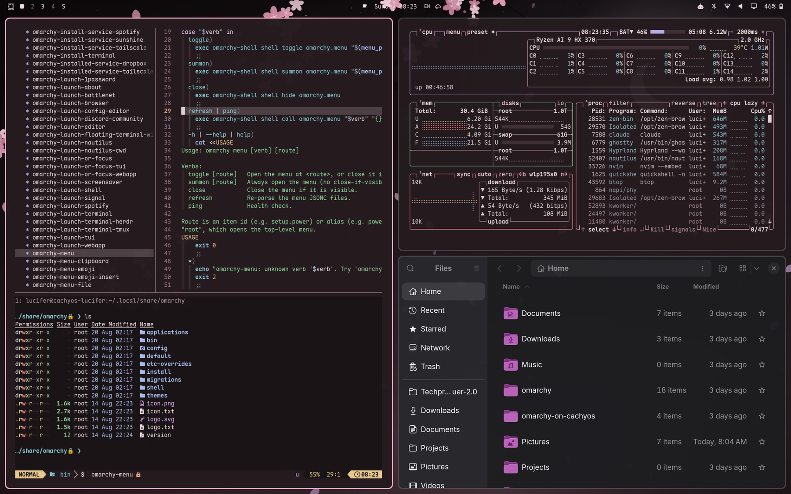

# Sakura

A theme for [Omarchy](https://omarchy.org).

```
Sakura — a soft-black, pink-primary theme for Omarchy.

Derived from the previous Clouds Anime Scenery Art palette, but with the
primary rotated onto pink and the background rebuilt the way Nord builds
its own: a desaturated near-black tinted toward the primary hue (338°)
instead of Nord's blue. Every foreground/accent below is checked against
the background for WCAG contrast and against its neighbours for CIEDE2000
separation, so no two terminal colors read alike.
```



## Install

```bash
omarchy theme install https://github.com/Sothcheat/omarchy-sakura-theme
```

This clones the theme into `~/.config/omarchy/themes/sakura` and applies it. Switch back any time with `omarchy theme set <name>`.

## Contents

- `colors.toml`: the palette. Omarchy generates every app's theme (terminals, Hyprland, Neovim, ...) from it.
- `icons.theme`: the GTK icon theme to use.
- `backgrounds/`: wallpapers. Cycle them with `omarchy theme bg next`.
